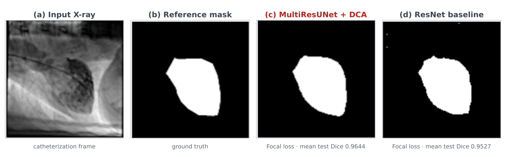
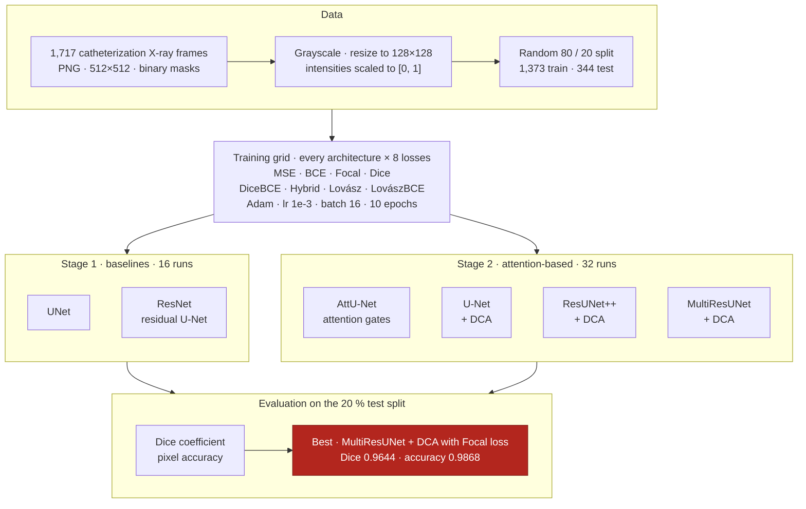

<div align="center">

# Attention-Based Network for Cardiac Systolic Abnormality Segmentation in Catheterization X-ray Images

**Masoud Noroozi**<sup>1</sup> · **Hossein Arabi**<sup>2</sup> · **Habib Zaidi**<sup>2</sup>

<sup>1</sup>Department of Biomedical Engineering, Faculty of Engineering, University of Isfahan, Isfahan, Iran<br>
<sup>2</sup>Division of Nuclear Medicine & Molecular Imaging, Geneva University Hospital, Geneva, Switzerland

*2024 IEEE Nuclear Science Symposium (NSS), Medical Imaging Conference (MIC)<br>and Room Temperature Semiconductor Detector Conference (RTSD)*

[](https://doi.org/10.1109/NSS/MIC/RTSD57108.2024.10655946)
[](https://colab.research.google.com/github/USERNAME/REPO/blob/main/Attention_Based_Network.ipynb)
[](https://www.kaggle.com/datasets/c7934597/cardiac-catheterization)
[](https://pytorch.org/)
[](https://www.python.org/)

[Overview](#overview) · [Pipeline](#experimental-pipeline) · [Results](#results) · [Getting started](#getting-started) · [Citation](#citation)



<sub><b>Fig. 1.</b> Example frame: (a) input, (b) reference mask, (c) best attention-based model, (d) best baseline. Dice values under (c) and (d) are means over the test split.</sub>

</div>

---

## Overview

| **1,717** | **6** | **8** | **48** | **0.9644** |
|:---:|:---:|:---:|:---:|:---:|
| catheterization X-ray frames | architectures | loss functions | trained configurations | best Dice |

Contrast left ventriculography, acquired during cardiac catheterization, is a well-established way to assess ejection fraction, hypertrophy and regional systolic abnormalities — yet its interpretation still relies largely on visual reading. Automatic segmentation of these frames is a first step toward objective, reproducible assessment.

This repository contains the complete implementation of our IEEE NSS/MIC/RTSD 2024 study: a controlled benchmark that asks two practical questions.

1. **Do attention mechanisms help?** Two convolutional baselines are compared with four attention-based encoder–decoders.
2. **Which loss should be used?** Eight objectives are compared, from pixel-wise and distribution-based to region-based and compound losses.

Every architecture is trained with every loss, and all 48 configurations are scored on the same held-out split.

## Highlights

- 🏆 **Best configuration:** MultiResUNet with Dual Cross-Attention (DCA) trained with Focal loss — Dice **0.9644**, pixel accuracy **0.9868**.
- **Attention-based models lead the table:** 25 of the 32 attention-based configurations exceed the best baseline (ResNet + Focal loss, Dice 0.9527).
- **Loss choice matters:** Dice loss is the best objective for three of the four attention models, and MultiResUNet + DCA is the strongest architecture under four of the eight losses.
- **Lovász hinge is the weakest loss** for five of the six architectures; with the compact UNet, training collapses (Dice 0.0003).

## Experimental pipeline



## Architectures

| Group | Model | What it adds | Implementation |
|---|---|---|---|
| Baseline | **UNet** | Four-level encoder–decoder [1] with concatenated skip connections and bilinear up-sampling; compact, with 4 base channels | this repository |
| Baseline | **ResNet** | The same U-Net topology with residual double-convolution blocks (1×1 projection shortcuts) in every down- and up-sampling stage | this repository |
| Attention | **AttU-Net** | Additive attention gates that re-weight skip features using the decoder signal [2] | [LeeJunHyun/Image_Segmentation](https://github.com/LeeJunHyun/Image_Segmentation) |
| Attention | **U-Net + DCA** | Dual Cross-Attention on the skip connections: channel and spatial cross-attention applied in sequence to multi-scale encoder features [3] | [gorkemcanates/Dual-Cross-Attention](https://github.com/gorkemcanates/Dual-Cross-Attention) |
| Attention | **ResUNet++ + DCA** | Residual units, squeeze-and-excitation, ASPP and decoder attention [4], with DCA skips | [gorkemcanates/Dual-Cross-Attention](https://github.com/gorkemcanates/Dual-Cross-Attention) |
| Attention | **MultiResUNet + DCA** | MultiRes blocks and Res-paths [5], with DCA skips | [gorkemcanates/Dual-Cross-Attention](https://github.com/gorkemcanates/Dual-Cross-Attention) |

The DCA variants are instantiated with `attention=True` for single-channel 128×128 input; in Table I of the paper they appear as `U-net`, `ResUnetPlus` and `MultiResUnet`.

## Loss functions

| Family | Losses, as named in the paper and notebook |
|---|---|
| Pixel-wise regression | `MSELoss` |
| Distribution-based | `BCELoss` · `FocalLoss` (α = 0.5, γ = 2) |
| Region-based | `DiceLoss` · `BinaryLovaszLoss` (Lovász hinge, from pytorch-toolbelt) [6] |
| Compound | `DiceBCELoss` (½ Dice + ½ BCE) · `LovaszBCELoss` (Lovász + BCE) · `HybridLoss` (BCE, Dice and a Sobel boundary-length term) |

Every model ends in a sigmoid, the losses are computed on the resulting probability maps, and predictions are binarised at 0.5 for evaluation.

## Results

Dice coefficient on the test split, reproduced from Table I of the paper.

<table>
  <thead>
    <tr><th rowspan="2" align="left">Loss</th><th colspan="2">Baselines</th><th colspan="4">Attention-based</th></tr>
    <tr><th>UNet</th><th>ResNet</th><th>AttU-Net</th><th>U-Net + DCA</th><th>ResUNet++ + DCA</th><th>MultiResUNet + DCA</th></tr>
  </thead>
  <tbody>
    <tr><td>MSE</td><td align="center"><b>0.9519</b></td><td align="center">0.9485</td><td align="center">0.9570</td><td align="center">0.9543</td><td align="center">0.9475</td><td align="center">0.9608</td></tr>
    <tr><td>BCE</td><td align="center">0.9486</td><td align="center">0.9485</td><td align="center">0.9585</td><td align="center">0.9562</td><td align="center">0.9532</td><td align="center">0.9566</td></tr>
    <tr><td>Focal</td><td align="center">0.9479</td><td align="center"><b>0.9527</b></td><td align="center">0.9615</td><td align="center">0.9619</td><td align="center">0.9577</td><td align="center"><b>0.9644</b>&nbsp;★</td></tr>
    <tr><td>Dice</td><td align="center">0.9165</td><td align="center">0.9339</td><td align="center"><b>0.9626</b></td><td align="center"><b>0.9631</b></td><td align="center"><b>0.9603</b></td><td align="center">0.9621</td></tr>
    <tr><td>DiceBCE</td><td align="center">0.9493</td><td align="center">0.9494</td><td align="center">0.9523</td><td align="center">0.9577</td><td align="center">0.9520</td><td align="center">0.9538</td></tr>
    <tr><td>Hybrid</td><td align="center">0.9452</td><td align="center">0.9443</td><td align="center">0.9590</td><td align="center">0.9600</td><td align="center">0.9558</td><td align="center">0.9607</td></tr>
    <tr><td>Lovász hinge</td><td align="center">0.0003&nbsp;‡</td><td align="center">0.9461</td><td align="center">0.9366</td><td align="center">0.9420</td><td align="center">0.9454</td><td align="center">0.9427</td></tr>
    <tr><td>LovászBCE</td><td align="center">0.9434</td><td align="center">0.9482</td><td align="center">0.9575</td><td align="center">0.9591</td><td align="center">0.9572</td><td align="center">0.9596</td></tr>
  </tbody>
</table>

<sub><b>Bold</b> = best loss for each architecture · ★ = best overall · ‡ = training collapsed.</sub>

<details>
<summary><b>Pixel accuracy for all 48 configurations</b></summary>
<br>

<table>
  <thead>
    <tr><th rowspan="2" align="left">Loss</th><th colspan="2">Baselines</th><th colspan="4">Attention-based</th></tr>
    <tr><th>UNet</th><th>ResNet</th><th>AttU-Net</th><th>U-Net + DCA</th><th>ResUNet++ + DCA</th><th>MultiResUNet + DCA</th></tr>
  </thead>
  <tbody>
    <tr><td>MSE</td><td align="center"><b>0.9834</b></td><td align="center">0.9820</td><td align="center">0.9849</td><td align="center">0.9841</td><td align="center">0.9820</td><td align="center">0.9858</td></tr>
    <tr><td>BCE</td><td align="center">0.9821</td><td align="center">0.9822</td><td align="center">0.9851</td><td align="center">0.9847</td><td align="center">0.9839</td><td align="center">0.9848</td></tr>
    <tr><td>Focal</td><td align="center">0.9820</td><td align="center"><b>0.9835</b></td><td align="center">0.9861</td><td align="center">0.9862</td><td align="center">0.9848</td><td align="center"><b>0.9868</b>&nbsp;★</td></tr>
    <tr><td>Dice</td><td align="center">0.9704</td><td align="center">0.9768</td><td align="center"><b>0.9865</b></td><td align="center"><b>0.9866</b></td><td align="center"><b>0.9858</b></td><td align="center">0.9863</td></tr>
    <tr><td>DiceBCE</td><td align="center">0.9822</td><td align="center">0.9823</td><td align="center">0.9835</td><td align="center">0.9559</td><td align="center">0.9570</td><td align="center">0.9837</td></tr>
    <tr><td>Hybrid</td><td align="center">0.9816</td><td align="center">0.9813</td><td align="center">0.9855</td><td align="center">0.9647</td><td align="center">0.9847</td><td align="center">0.9859</td></tr>
    <tr><td>Lovász hinge</td><td align="center">0.8456</td><td align="center">0.9817</td><td align="center">0.9796</td><td align="center">0.9810</td><td align="center">0.9819</td><td align="center">0.9812</td></tr>
    <tr><td>LovászBCE</td><td align="center">0.9811</td><td align="center">0.9823</td><td align="center">0.9852</td><td align="center">0.9856</td><td align="center">0.9851</td><td align="center">0.9857</td></tr>
  </tbody>
</table>

</details>

## Getting started

### Option A · Google Colab (the paper's setup)

1. Download **Cardiac Catheterization X-Ray PNG 512x512** from [Kaggle](https://www.kaggle.com/datasets/c7934597/cardiac-catheterization) and save the archive to your Google Drive as `MyDrive/cardiac-catheterization.zip` (rename it if your browser saves it as `archive.zip`).
2. Open the notebook with the **Open in Colab** badge above and choose *Runtime → Change runtime type → T4 GPU*.
3. Set `epochs = 10` in both training cells to match the published protocol (the notebook default is 20).
4. Choose *Runtime → Run all*. The notebook installs its dependencies, clones the third-party models, unzips the data, trains every configuration and plots train/test Dice curves for each run.

### Option B · Local machine

```bash
git clone https://github.com/USERNAME/REPO.git && cd REPO

pip install torch torchvision numpy opencv-python scikit-learn matplotlib \
            pytorch-toolbelt torchinfo einops medpy torchmetrics thop jupyter kaggle

git clone https://github.com/LeeJunHyun/Image_Segmentation
git clone https://github.com/gorkemcanates/Dual-Cross-Attention Dual_Cross_Attention

kaggle datasets download -d c7934597/cardiac-catheterization   # or download it manually
mkdir -p dataset && unzip cardiac-catheterization.zip -d dataset
jupyter notebook Attention_Based_Network.ipynb
```

Then run the notebook from the imports cell onward; the first four cells only handle installation, cloning and Google Drive. A CUDA GPU is strongly recommended.

**Expected data layout**

```text
dataset/
└── Cardiac_Catheterization/
    └── train/
        ├── images/   # catheterization X-ray frames (PNG)
        └── masks/    # binary segmentation masks (PNG)
```

### Repository structure

```text
.
├── Attention_Based_Network.ipynb   # end-to-end pipeline: data → 48 training runs → metrics & plots
├── assets/
│   └── qualitative_results.png     # Fig. 1
├── LICENSE
└── README.md
```

### Notebook map

| Section | What it does |
|---|---|
| Setup cells | Installs packages, clones the third-party models, mounts Google Drive and unzips the dataset |
| **Loading Data** | Reads frames and masks in grayscale, resizes to 128×128, performs the 80/20 split and builds the data loaders |
| **Model** | Metrics (accuracy, Dice, Jaccard, sensitivity, specificity, F1, HD95, mIoU), the UNet and ResNet baselines, the `ModelFit` training loop and plotting helpers |
| **Loss Functions** | Focal, Dice, DiceBCE, Hybrid and LovászBCE losses |
| **Checking model with different losses** | Stage 1: UNet and ResNet × 8 losses, including FLOP and parameter counts |
| **Attention Models** | Stage 2: attention-based architectures × 8 losses |

## Experimental protocol

| Setting | Value |
|---|---|
| Input | Single-channel frames, resized from 512×512 to 128×128, intensities scaled to [0, 1] |
| Split | Random 80 / 20 (`train_test_split`, `random_state = 0`): 1,373 training and 344 test frames |
| Optimiser | Adam, learning rate 1 × 10⁻³ |
| Batch size | 16, with incomplete final batches dropped |
| Epochs | 10, as reported in the paper |
| Output | Sigmoid probability map, binarised at 0.5 |
| Reported metrics | Dice coefficient and pixel accuracy at the final epoch |
| Metric aggregation | Computed on each test mini-batch (16 frames pooled) and averaged over the 21 full batches, i.e. 336 of the 344 test frames |
| Also logged | Jaccard (IoU), sensitivity, specificity, F1, HD95 and mIoU |
| Hardware | NVIDIA Tesla T4, 16 GB (Google Colab) |

Segmentation overlap is measured with the Dice similarity coefficient (Eq. 1 of the paper):

$$
\mathrm{Dice}(A_P, A_T) = \frac{2\,\lvert A_P \cap A_T \rvert}{\lvert A_P \rvert + \lvert A_T \rvert}
$$

where $A_P$ is the binarised prediction and $A_T$ the reference mask.

> [!NOTE]
> **Reproducibility notes**
> - The paper trains for **10 epochs**, whereas the notebook ships with `epochs = 20`; edit both training cells to match the published protocol.
> - The notebook's attention list also instantiates **R2AttU-Net, V-Net + DCA and R2U-Net + DCA**. Their results are not reported in the paper.
> - The split is seeded, but weight initialisation and batch shuffling are not, so expect small run-to-run differences.
> - Third-party architectures are cloned at run time from their original repositories and are not redistributed here.

## Citation

If this work or code is useful in your research, please cite:

```bibtex
@inproceedings{noroozi2024attention,
  author    = {Noroozi, Masoud and Arabi, Hossein and Zaidi, Habib},
  title     = {Attention-Based Network for Cardiac Systolic Abnormality Segmentation in Catheterization X-ray Images},
  booktitle = {2024 IEEE Nuclear Science Symposium (NSS), Medical Imaging Conference (MIC) and Room Temperature Semiconductor Detector Conference (RTSD)},
  pages     = {1--2},
  year      = {2024},
  publisher = {IEEE},
  doi       = {10.1109/NSS/MIC/RTSD57108.2024.10655946}
}
```

<details>
<summary>Plain-text citation (IEEE style)</summary>
<br>

M. Noroozi, H. Arabi, and H. Zaidi, "Attention-Based Network for Cardiac Systolic Abnormality Segmentation in Catheterization X-ray Images," in *2024 IEEE Nuclear Science Symposium (NSS), Medical Imaging Conference (MIC) and Room Temperature Semiconductor Detector Conference (RTSD)*, 2024, pp. 1–2, doi: [10.1109/NSS/MIC/RTSD57108.2024.10655946](https://doi.org/10.1109/NSS/MIC/RTSD57108.2024.10655946).

</details>

## Acknowledgements

- **Dataset:** W.-M. Lin, *Cardiac Catheterization X-Ray PNG 512x512*, [Kaggle](https://www.kaggle.com/datasets/c7934597/cardiac-catheterization). Please follow the dataset's terms of use.
- **Attention U-Net** implementation: [LeeJunHyun/Image_Segmentation](https://github.com/LeeJunHyun/Image_Segmentation).
- **Dual Cross-Attention** and the DCA-equipped U-Net, ResUNet++ and MultiResUNet: [gorkemcanates/Dual-Cross-Attention](https://github.com/gorkemcanates/Dual-Cross-Attention).
- **Lovász hinge** loss: [pytorch-toolbelt](https://github.com/BloodAxe/pytorch-toolbelt).

<details>
<summary><b>References</b></summary>
<br>

1. O. Ronneberger, P. Fischer, and T. Brox, "U-Net: Convolutional networks for biomedical image segmentation," in *MICCAI*, 2015.
2. O. Oktay *et al.*, "Attention U-Net: Learning where to look for the pancreas," *arXiv:1804.03999*, 2018.
3. G. C. Ates, P. Mohan, and E. Celik, "Dual cross-attention for medical image segmentation," *Engineering Applications of Artificial Intelligence*, vol. 126, p. 107139, 2023.
4. D. Jha *et al.*, "ResUNet++: An advanced architecture for medical image segmentation," in *IEEE International Symposium on Multimedia (ISM)*, 2019.
5. N. Ibtehaz and M. S. Rahman, "MultiResUNet: Rethinking the U-Net architecture for multimodal biomedical image segmentation," *Neural Networks*, vol. 121, pp. 74–87, 2020.
6. M. Berman, A. Rannen Triki, and M. B. Blaschko, "The Lovász-Softmax loss: A tractable surrogate for the optimization of the intersection-over-union measure in neural networks," in *CVPR*, 2018.

</details>

## License

The code in this repository is released under the terms in [`LICENSE`](LICENSE). Third-party architectures are fetched at run time and remain under their original terms (Dual-Cross-Attention: MIT License; Image_Segmentation: see the original repository). The dataset is subject to its Kaggle terms of use.

## Contact

For questions or bug reports, please open a [GitHub issue](../../issues).


> [!CAUTION]
> **Research use only.** This software is not a medical device and has not been validated for clinical decision-making.
